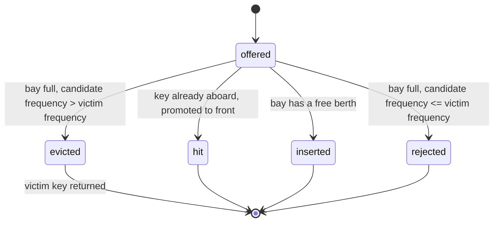
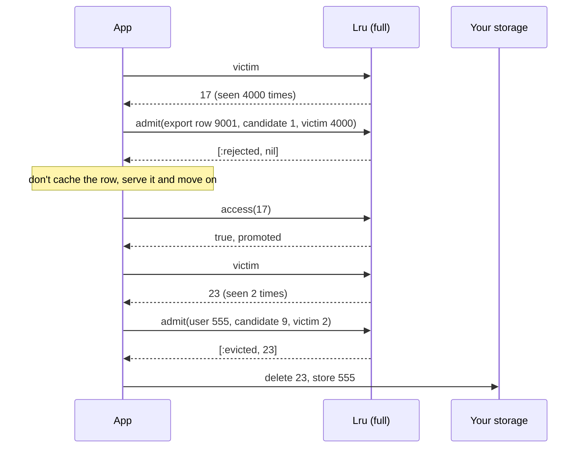

# CacheMachines

> Sixty-four berths, and a hatch that asks what you've done to deserve one. 📦

An admission-controlled LRU for Ruby. It keeps the most recently used keys in order, names the one it would throw out next, and refuses to throw it out for a newcomer that isn't worth more. You store the payloads and count the hits. It decides what stays.

## Quick Start

```bash
gem 'cache_machines'
```

```ruby
bay = CacheMachines::Lru.new

bay.admit(42, candidate_frequency: 1, victim_frequency: 0)  # => [:inserted, nil]
bay.admit(7,  candidate_frequency: 1, victim_frequency: 0)  # => [:inserted, nil]
bay.access(42)                                              # => true
bay.keys                                                    # => [42, 7]
bay.remove(7)                                               # => true
```

Keys are Integers. Pair them with your own storage, hand the decisions to the bay, and the bay tells you what to keep.

## A Message to the Resistance

So you built an LRU cache. Hot rows stay, cold rows fall off the back, dashboards go green. Then the nightly export job runs. It reads every row in the table exactly once, and every one of those reads is a cache miss that inserts a key you will never ask for again.

By the time the export finishes, your working set is gone. The 64 keys that got hit ten thousand times each have been shoved out by 64 keys that got hit once. Monday morning is a cold start, and the LRU did exactly what you told it to do.

LRU answers "what was used least recently?" It never asks "does the newcomer deserve the slot?" This gem asks. When the bay is full, a candidate has to show up with a higher frequency than the key it would evict. Ties lose. The export job's keys never make it past the hatch.

## Chapter 1: Stardate 2025.186, the AMS Denning

> **AMS Denning**, NCC-4203, *Denning*-class cache tender.
> The hold is finite. The universe of possible consignments is not.

The tender has 64 berths and no more. Every consignment that arrives is logged by key, and the manifest is kept in order of last use. When the bay is full and something new arrives, the quartermaster names the berth at the back, asks how often each has been requisitioned, and only swaps if the newcomer wins outright.

Somewhere in the fleet, a supply officer proposes:

```ruby
def fetch(key)
  @cache[key] ||= load(key)     # Hash with 64 entries, oldest shifted off
end
```

"That," says the quartermaster, "is how one inventory scan empties the bay."

## The Flight Plan

What happens to a key offered to `admit`:



And the night of the export job:



## How the Bay Works

### Admit

`admit` takes the key, how often the candidate has been requested, and how often the current victim has. It returns a status and, only when something was displaced, the evicted key.

```ruby
bay = CacheMachines::Lru.new
bay.admit(1, candidate_frequency: 5, victim_frequency: 0)  # => [:inserted, nil]
bay.admit(1, candidate_frequency: 5, victim_frequency: 0)  # => [:hit, nil]
```

While there's a free berth, frequencies don't matter. The candidate gets in. A key already aboard is a `:hit` and moves to the front.

### When the bay is full

Fill all 64 berths and the frequencies start to count.

```ruby
bay = CacheMachines::Lru.new
64.times { |key| bay.admit(key, candidate_frequency: 0, victim_frequency: 0) }

bay.victim                                                     # => 0
bay.admit(100, candidate_frequency: 9,  victim_frequency: 9)   # => [:rejected, nil]
bay.admit(100, candidate_frequency: 8,  victim_frequency: 9)   # => [:rejected, nil]
bay.admit(100, candidate_frequency: 10, victim_frequency: 9)   # => [:evicted, 0]
```

Equal loses. Lower loses. Only strictly higher gets a berth, and then you are told exactly which key just left so you can drop its payload.

### Access

A hit promotes the key to the front and returns `true`. A miss returns `false` and inserts nothing. Reading is never admitting.

```ruby
bay = CacheMachines::Lru.new
bay.admit(1, candidate_frequency: 0, victim_frequency: 0)
bay.admit(2, candidate_frequency: 0, victim_frequency: 0)

bay.keys        # => [2, 1]
bay.access(1)   # => true
bay.keys        # => [1, 2]
bay.access(9)   # => false
bay.size        # => 2
```

### Victim

`victim` is the key at the back of the line, the one `admit` would evict. It is `nil` until the bay is full. Ask for it right before you admit, look up its frequency, and pass that in.

```ruby
bay = CacheMachines::Lru.new
bay.victim                                                   # => nil
64.times { |key| bay.admit(key, candidate_frequency: 0, victim_frequency: 0) }
bay.victim                                                   # => 0
bay.access(0)
bay.victim                                                   # => 1
```

### Remove and clear

```ruby
bay = CacheMachines::Lru.new
bay.admit(1, candidate_frequency: 0, victim_frequency: 0)
bay.remove(1)   # => true
bay.remove(1)   # => false
bay.clear       # => nil
bay.empty?      # => true
```

`keys` is a snapshot, most recent first. Mutate the array all you like; the bay doesn't notice.

## The Rules of the Tender

- **Capacity is 64**, exposed as `CacheMachines::Lru::CAPACITY`. The constructor takes no arguments.
- **Keys and frequencies are Integers** in `0..2**64-1`. Floats, strings, nil, and objects with `to_int` raise `TypeError`. Negative or too large raises `RangeError`. Bad input is rejected before anything changes.
- **Both frequencies are keyword arguments** and both are required. Missing or extra keywords raise `ArgumentError`.
- **Frequencies are yours.** The bay never counts hits. It compares the two numbers you give it and nothing else.
- **Frozen means frozen.** After `freeze`, every mutator raises `FrozenError`, including a miss on `access` and a `remove` of a key that isn't there.

## What You Think You're Doing vs Reality

### You Think: "A bigger cache would have survived the export."
### Reality: Any finite cache loses to a scan larger than itself.

The export touches more rows than you have berths. Doubling the bay means it takes twice as long to flush, then flushes anyway. The fix is not more room. The fix is a hatch that asks whether the newcomer has earned a berth, and the answer for a row read once is no.

## What's Yours

The bay holds keys and order, nothing else. Payloads live in your store, and when `admit` returns `:evicted` you delete that payload yourself. Frequency counting is yours too, whether that's a counter per key, a sketch, or a column you already have. Treat `victim` then `admit` as one step in your code; the bay won't stop another thread from slipping in between.

## License

MIT License. See [LICENSE.txt](LICENSE.txt) for details.

**Remember: The export job will read every row once. Make sure once is not enough.**
